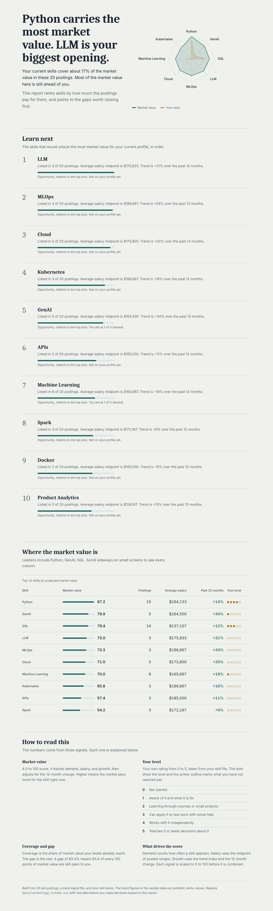
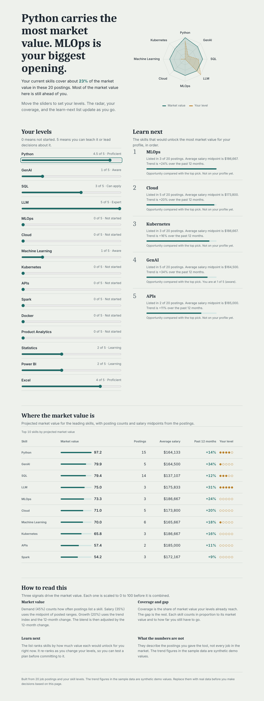
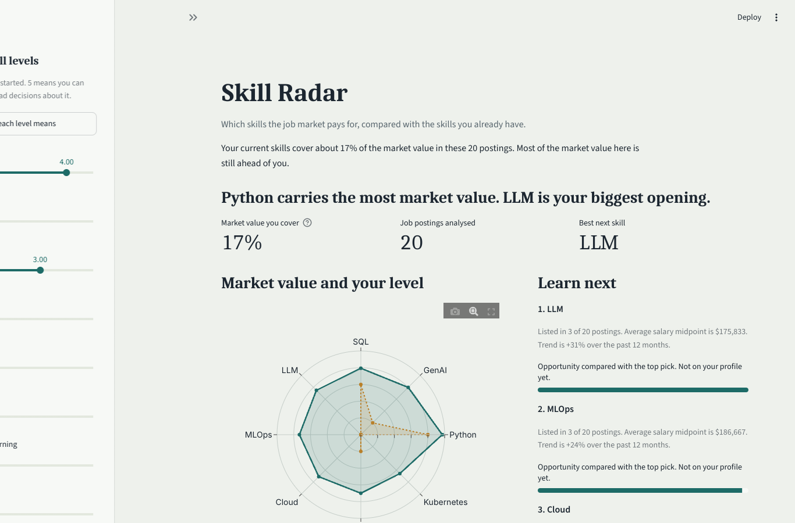

# Skill Radar

Skill Radar shows which data and AI skills job postings reward most, and how your own skill levels compare. It then recommends what to learn next, in order of how much market value each skill would unlock for you.

It comes in four forms:

- **A command-line tool** for a quick answer in the terminal.
- **A standalone HTML report** you can open in any browser, share, or print. It needs no server or internet connection.
- **An animated, interactive page** (one self-contained HTML file). Move the sliders to set your levels and watch coverage, the radar, and the learn-next list update.
- **An interactive dashboard** built with Streamlit, for exploring the data in a Python environment.

All four read the same CSV files and use the same scoring, so they always agree.

## Quick start

You need Python 3.10 or newer.

```bash
python3 -m venv .venv
source .venv/bin/activate        # Windows: .venv\Scripts\activate
pip install -e ".[dev]"
```

Then pick how you want to see the results:

```bash
skill-gap-radar analyze                  # summary in the terminal
skill-gap-radar report                   # writes outputs/skill_gap_radar_report.html
skill-gap-radar page                     # writes outputs/skill_radar.html (animated, interactive)
streamlit run src/skill_gap_radar/app.py # interactive dashboard at http://localhost:8501
```

Run the commands from the project root so the default paths resolve.

## What you will see

- **A headline** that names the strongest skill in the market and your best next move.
- **A coverage figure** showing how much of the market value your current skills already reach.
- **A radar chart** that compares market value (teal) with your own levels (amber) for the top skills.
- **A learn-next list** of the skills that would add the most value, each with the reason it ranks there.
- **A full table** of skills with demand, salary, growth, and your level.

## Screenshots

**Standalone report** (`skill-gap-radar report`):



**Animated page** (`skill-gap-radar page`):



**Dashboard** (`streamlit run src/skill_gap_radar/app.py`):



## Using your own data

Replace the files in `data/` with your own exports. Every file must include the columns listed below. Column names are case-sensitive. Files saved from Excel with a UTF-8 byte-order mark are fine.

**`sample_job_postings.csv`**: one row per posting.

| Column | Example | Notes |
| --- | --- | --- |
| `job_id` | `1` | Any unique value |
| `title` | `Data Scientist` | |
| `company` | `Northstar Analytics` | |
| `location` | `Remote` | Not used in scoring yet |
| `posted_date` | `2026-09-10` | `YYYY-MM-DD`. Validated, not yet used in scoring |
| `salary_min` | `118000` | Yearly, in your currency |
| `salary_max` | `155000` | Must be at least `salary_min` |
| `skills` | `Python;SQL;Statistics` | Semicolon-separated |

**`technology_trends.csv`**: one row per skill.

| Column | Example | Notes |
| --- | --- | --- |
| `skill` | `GenAI` | Skills missing from this file get neutral growth values |
| `trend_index` | `94` | 0 to 100 |
| `change_12m_pct` | `34` | Percent change over the last 12 months |
| `source_note` | `Industry survey, Q3` | Free text, kept for your records |

**`user_skills.csv`**: your current levels.

| Column | Example | Notes |
| --- | --- | --- |
| `skill` | `Python` | |
| `level` | `4` | 0 (not started) to 5 (expert). Values outside the range are clamped |

If a file is missing a column or a value cannot be read, Skill Radar stops and names the file and line number.

## How the score works

Each skill gets three signals, each scaled to 0 to 100 and combined:

| Signal | Weight | What it measures |
| --- | --- | --- |
| Demand | 45% | How often postings list the skill |
| Salary | 35% | The average salary midpoint of postings that list it |
| Growth | 20% | The trend index and the 12-month change |

**Market value** is the blend, adjusted by the 12-month change. **Coverage** is the share of market value your levels already reach. **Gap** is the rest. A higher gap means more opportunity to learn. Full formulas, worked examples, and known limits are in [docs/methodology.md](docs/methodology.md).

## Project layout

```text
.
├── data/                       Input CSV files
├── docs/
│   ├── methodology.md         How the scores are calculated
│   └── screenshots/            Images used in this README
├── outputs/                    Generated reports (created by `skill-gap-radar report`)
├── src/skill_gap_radar/
│   ├── analytics.py            Scoring, gap, and recommendations
│   ├── app.py                  Streamlit dashboard
│   ├── animated_page.py        Builds the animated, interactive page
│   ├── cli.py                  Command-line interface
│   ├── data_loader.py          CSV loading and validation
│   ├── insights.py             Plain-language wording shared across outputs
│   ├── models.py               Data classes
│   ├── report.py               Standalone HTML report
│   └── templates/
│       └── animated_page.html  Page template (layout, styles, and script)
├── tests/                      Unit and smoke tests
├── .streamlit/config.toml      Dashboard theme
└── pyproject.toml
```

## Running the tests

```bash
pytest
```

The suite covers the scoring rules, data validation, the HTML report and animated page (including escaping and that the page makes no network requests), the CLI, and a headless run of the dashboard.

## Limits to keep in mind

- The included trend figures are **synthetic demo values**. Replace them with real data before you make career or hiring decisions.
- The sample postings are illustrative. Results are only as broad as the postings you feed in.
- Posting dates are checked but do not yet affect the score. Recent postings currently count the same as older ones.

## Roadmap

- Weight recent postings more heavily, using `posted_date`.
- Normalize salaries by location and currency.
- Track changes month by month to show trends over time.
- Group related skills with embeddings.
- Read a resume to fill in your skill levels automatically.

## License

MIT. See [LICENSE](LICENSE).
